<picture>
  <source media="(prefers-color-scheme: dark)" srcset="assets/header-dark.svg">
  
</picture>

### Highlights

<!-- Keep each row on one line: whitespace between two 50% cards pushes the second one down. -->

<a href="https://drivepass.cz"><picture><source media="(prefers-color-scheme: dark)" srcset="assets/cards/drivepass-dark.svg">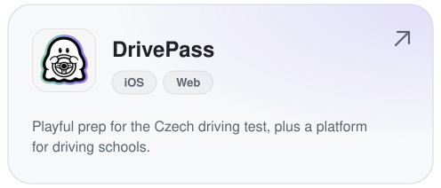</picture></a><a href="https://github.com/Rektoooooo/bow"><picture><source media="(prefers-color-scheme: dark)" srcset="assets/cards/bow-dark.svg">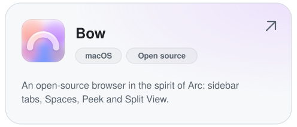</picture></a> 
<a href="https://github.com/Rektoooooo/CC-Settings"><picture><source media="(prefers-color-scheme: dark)" srcset="assets/cards/cc-settings-dark.svg">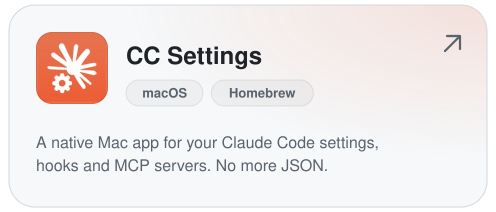</picture></a><a href="https://github.com/Rektoooooo/StayAwake"><picture><source media="(prefers-color-scheme: dark)" srcset="assets/cards/stayawake-dark.svg">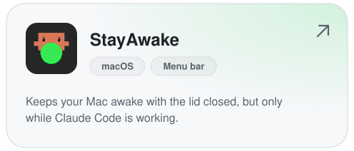</picture></a>

### More projects

<a href="https://apps.apple.com/app/shadowlift/id6743451583"><picture><source media="(prefers-color-scheme: dark)" srcset="assets/apps/shadowlift-dark.svg">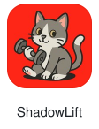</picture></a>&nbsp;<a href="https://apps.apple.com/app/myhabitowl/id6757938878"><picture><source media="(prefers-color-scheme: dark)" srcset="assets/apps/myhabitowl-dark.svg">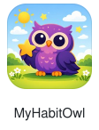</picture></a>&nbsp;<a href="https://github.com/Rektoooooo/MealPrepAI"><picture><source media="(prefers-color-scheme: dark)" srcset="assets/apps/mealprepai-dark.svg">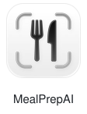</picture></a>&nbsp;<a href="https://github.com/Rektoooooo/mycartally-ios"><picture><source media="(prefers-color-scheme: dark)" srcset="assets/apps/mycartally-dark.svg">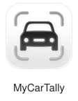</picture></a>&nbsp;<a href="https://github.com/Rektoooooo/computational-redstone"><picture><source media="(prefers-color-scheme: dark)" srcset="assets/apps/redstone-dark.svg">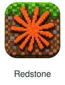</picture></a>

### Stack

<picture><source media="(prefers-color-scheme: dark)" srcset="assets/stack/swift-dark.svg">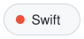</picture>
<picture><source media="(prefers-color-scheme: dark)" srcset="assets/stack/swiftui-dark.svg"></picture>
<picture><source media="(prefers-color-scheme: dark)" srcset="assets/stack/swiftdata-dark.svg"></picture>
<picture><source media="(prefers-color-scheme: dark)" srcset="assets/stack/cloudkit-dark.svg">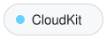</picture>
<picture><source media="(prefers-color-scheme: dark)" srcset="assets/stack/healthkit-dark.svg">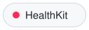</picture>
<picture><source media="(prefers-color-scheme: dark)" srcset="assets/stack/widgetkit-dark.svg">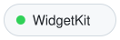</picture>
<picture><source media="(prefers-color-scheme: dark)" srcset="assets/stack/typescript-dark.svg"></picture>
<picture><source media="(prefers-color-scheme: dark)" srcset="assets/stack/react-dark.svg">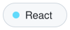</picture>
<picture><source media="(prefers-color-scheme: dark)" srcset="assets/stack/next-js-dark.svg"></picture>
<picture><source media="(prefers-color-scheme: dark)" srcset="assets/stack/electron-dark.svg"></picture>
<picture><source media="(prefers-color-scheme: dark)" srcset="assets/stack/supabase-dark.svg">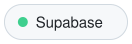</picture>
<picture><source media="(prefers-color-scheme: dark)" srcset="assets/stack/claude-code-dark.svg"></picture>

 

Say hi at <a href="mailto:sebastian.kucera@icloud.com">sebastian.kucera@icloud.com</a>

